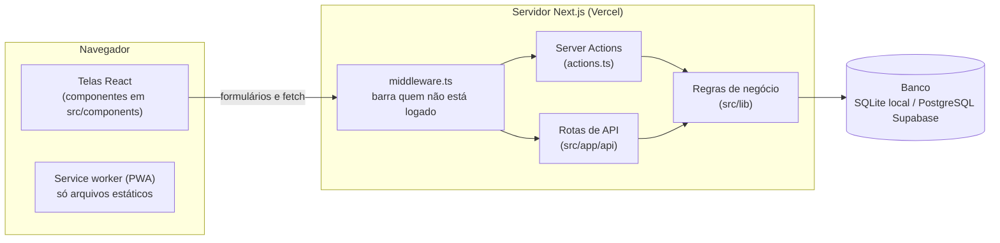
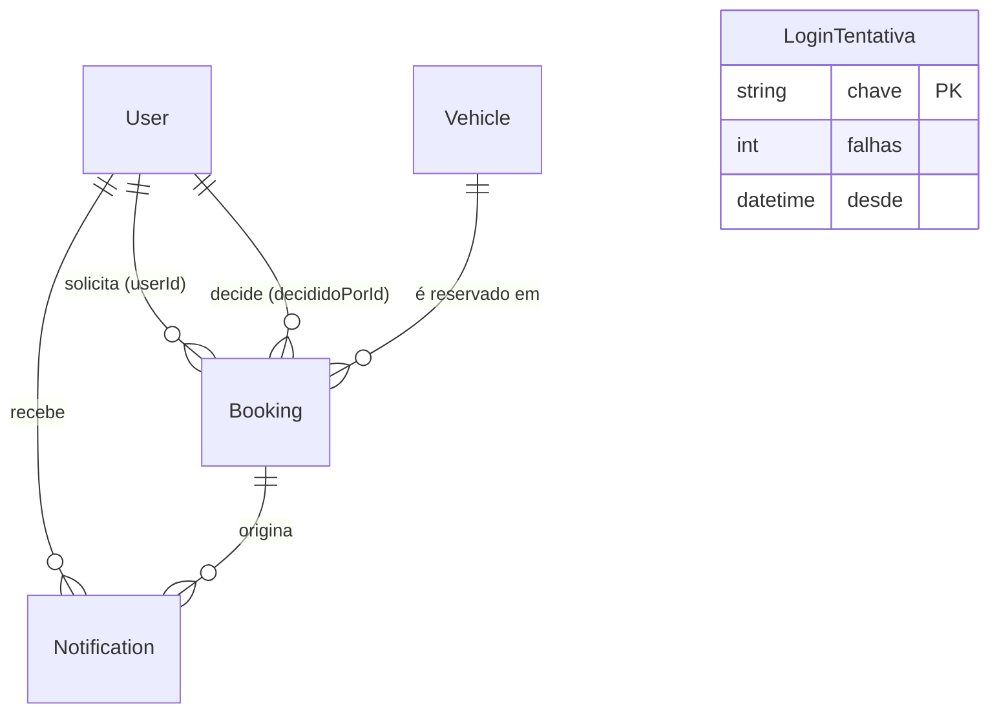
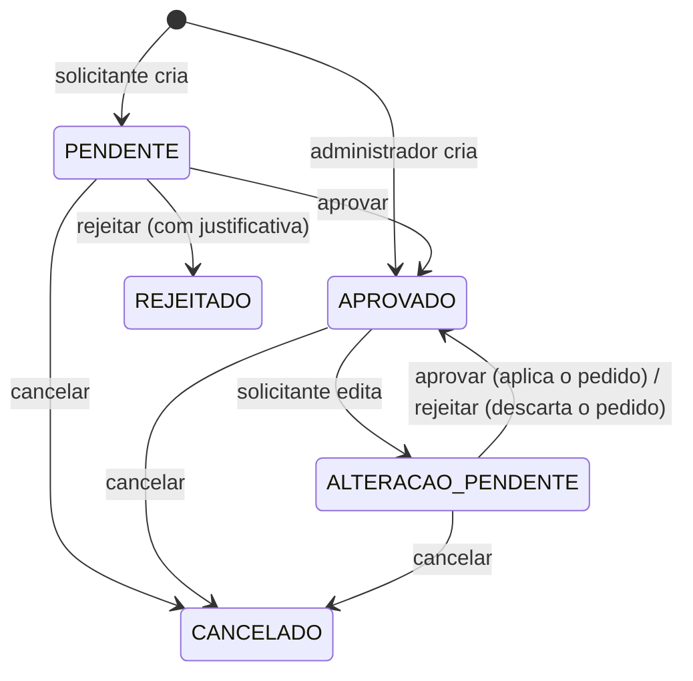

# Documentação técnica — Agendamento de Veículos (Comurg)

Sistema web interno para **solicitação, aprovação e controle de uso de veículos**. Este documento descreve a arquitetura, o modelo de dados,
as regras de negócio, a segurança e como evoluir o código. Para uso do sistema veja o [Manual](MANUAL.md); para publicar, o [guia de publicação](DEPLOY.md).

## Sumário
1. [Visão geral](#1-visão-geral)
2. [Tecnologias](#2-tecnologias)
3. [Arquitetura](#3-arquitetura)
4. [Estrutura do projeto](#4-estrutura-do-projeto)
5. [Modelo de dados](#5-modelo-de-dados)
6. [Autenticação e permissões](#6-autenticação-e-permissões)
7. [Regras de negócio](#7-regras-de-negócio)
8. [Telas, rotas e APIs](#8-telas-rotas-e-apis)
9. [Padrões de código](#9-padrões-de-código)
10. [Relatórios](#10-relatórios)
11. [App instalável (PWA)](#11-app-instalável-pwa)
12. [Configuração e comandos](#12-configuração-e-comandos)
13. [Ambientes e banco de dados](#13-ambientes-e-banco-de-dados)
14. [Segurança e LGPD](#14-segurança-e-lgpd)
15. [Testes e qualidade](#15-testes-e-qualidade)
16. [Limitações conhecidas](#16-limitações-conhecidas)
17. [Como evoluir o sistema](#17-como-evoluir-o-sistema)

---

## 1. Visão geral

| | |
|---|---|
| **Objetivo** | Usuários pedem veículos (data, início e fim); o administrador aprova ou rejeita; o calendário mostra a ocupação. |
| **Perfis** | `USER` (solicitante) e `ADMIN` (administrador). |
| **Entidades** | Usuários, veículos, agendamentos, notificações. |
| **Hospedagem prevista** | Vercel (aplicação) + Supabase (PostgreSQL). Em desenvolvimento: tudo local com SQLite. |
| **Idioma** | Interface e código de negócio em português; infraestrutura em inglês. |
| **Fuso horário** | Brasília (UTC−3, fixo). O banco guarda UTC. |

## 2. Tecnologias

| Camada | Tecnologia |
|---|---|
| Aplicação | **Next.js 15** (App Router, Server Actions) e **React 19**, em **TypeScript** |
| Estilo | **Tailwind CSS 4**; cores da Comurg em `src/app/globals.css` |
| Calendário | **FullCalendar 6** |
| Banco / acesso | **Prisma 6** — SQLite (desenvolvimento) e PostgreSQL (produção) |
| Autenticação | **Auth.js (next-auth 4)**, provedor de credenciais, sessão em JWT |
| Validação | **zod 4** |
| Senhas | **bcryptjs** |
| Relatórios | **exceljs** (Excel) e **pdfkit** (PDF) |
| Testes | **vitest** |

## 3. Arquitetura

É uma aplicação **monolítica full-stack**: front e back no mesmo projeto. O navegador nunca fala com o banco; tudo passa pelo servidor.



- **Front:** páginas e componentes React. Páginas são, em sua maioria, *Server Components* (consultam o banco no servidor e enviam HTML);
  partes interativas (calendário, pop-ups, sino) são *Client Components* (`"use client"`).
- **Back:** *Server Actions* (`"use server"`) para gravações, rotas em `src/app/api` para dados de calendário, notificações, relatórios e saúde.
- **Regras de negócio:** em TypeScript, em `src/lib`, com testes. Ficam no back, e não no banco, para serem as mesmas em qualquer ambiente.
  O banco só reforça duas regras (ver [seção 13](#13-ambientes-e-banco-de-dados)).

## 4. Estrutura do projeto

```
prisma/
  schema.prisma              Modelo de dados (fonte única; SQLite)
  migrations/                Migrações do SQLite (desenvolvimento)
  postgres/                  Versão PostgreSQL (schema gerado, migrações de produção, SQL para o Supabase)
  seed.ts, seed-unidades.ts  Dados de teste (NÃO usar em produção)
scripts/                     create-admin, backup, geração do schema/SQL PostgreSQL
public/                      Logo, service worker, página "sem conexão"
docs/                        Manual, publicação e esta documentação
src/
  app/
    (app)/admin/...          Telas do administrador
    (app)/usuario/...        Telas do solicitante
    actions/                 Server Actions compartilhadas (km, notificações)
    api/                     Rotas de API (auth, calendário, notificações, relatórios, health)
    login/, trocar-senha/    Telas públicas / de primeiro acesso
    manifest.ts, icon.tsx    PWA
  components/                Componentes de interface (AppShell, CalendarView, pop-ups, formulários)
  lib/                       Regras de negócio, validação, autenticação, relatórios, datas
  middleware.ts              Proteção de rotas
  types/                     Tipos auxiliares (next-auth, css)
```

Os grupos `(app)` não aparecem na URL: `src/app/(app)/admin/usuarios` responde em `/admin/usuarios`.

### Módulos principais de `src/lib`

| Arquivo | Responsabilidade |
|---|---|
| `booking-rules.ts` | Janela de horário (antecedência mínima, duração máxima), sobreposição, quem pode editar/cancelar. |
| `booking-service.ts` | Esquema de validação do agendamento (`bookingSchema`), `validarRegras`, conflito com reservas aprovadas, notificações. |
| `km.ts`, `km-lembretes.ts` | Quilometragem: validação, referências do veículo, pendências e lembretes. |
| `auth.ts` | Configuração do login, `getSession` (confere o usuário no banco), `requireUser`/`requireAdmin`. |
| `senha.ts`, `rate-limit.ts` | Regra da senha, senha provisória aleatória, versão da senha (sessões), limite de tentativas de login. |
| `validation.ts` | Esquemas zod de usuário e veículo. |
| `action.ts` | Utilitários das Server Actions (`validar`, `voltar`, `retornoSeguro`). |
| `datetime.ts` | Conversões de fuso (Brasília ↔ UTC) e formatação. |
| `status.ts` | Rótulos e cores dos status (fonte única). |
| `reports.ts`, `reports-summary.ts`, `report-export.ts` | Filtros, resumo e exportação Excel/PDF. |
| `env.ts` | Verificação das variáveis em produção. |

## 5. Modelo de dados



### `User`
| Campo | Observação |
|---|---|
| `nome`, `email` (único), `senhaHash` | `email` em minúsculas. A senha nunca é guardada em texto. |
| `matricula` (única, opcional) | Também serve para o login. |
| `telefone`, `cargo`, `setor` (lotação), `contato` | Obrigatórios no cadastro pelo administrador. |
| `role` | `ADMIN` ou `USER`. |
| `ativo` | `false` bloqueia o acesso na hora (sem apagar histórico). |
| `trocarSenha` | `true` enquanto usa a senha provisória: força a troca no primeiro acesso. |

### `Vehicle`
`prefixo` (único), `placa` (única), `tipo`, `lotacao`, `contrato` (opcional), `status` (`ATIVO`, `MANUTENCAO`, `INATIVO`), `observacao`.
Só veículos `ATIVO` aceitam solicitações.

### `Booking` (agendamento)
| Campo | Observação |
|---|---|
| `userId`, `vehicleId` | Solicitante e veículo. |
| `inicio`, `fim` | Instantes em UTC. Intervalo semiaberto `[inicio, fim)`. |
| `destino`, `passageiros` (inclui o motorista), `motorista` (opcional) | Dados da viagem. |
| `kmInicial`, `kmFinal` | Hodômetro, informados pelo solicitante (o administrador corrige). |
| `termoAceitoEm` | Data/hora do aceite do Termo de Responsabilidade ao criar. |
| `status` | `PENDENTE`, `APROVADO`, `REJEITADO`, `CANCELADO`, `ALTERACAO_PENDENTE`. |
| `decididoPorId`, `decididoEm`, `justificativa` | Quem decidiu, quando e o motivo (obrigatório ao rejeitar). |
| `versaoAnterior` | JSON do **pedido de alteração** (só com status `ALTERACAO_PENDENTE`). A reserva continua com os dados aprovados até a decisão. O nome do campo vem do formato antigo, em que o JSON guardava a versão aprovada (convertido pela migração `0005`). |

Índices: `(vehicleId, inicio, fim)`, `status`, `inicio`, `userId`.

### `Notification`
`userId`, `tipo`, `mensagem`, `bookingId` (opcional), `lida`, `criadoEm`. Apagada junto com o usuário ou agendamento.
Tipos em uso: `NOVA_SOLICITACAO`, `ALTERACAO`, `CANCELAMENTO`, `APROVADO`, `REJEITADO`, `ALTERACAO_REJEITADA`, `CANCELADO`, `EDITADO_ADMIN`, `KM_PENDENTE`, `KM_AJUSTADO`.
Notificações lidas há mais de 30 dias são apagadas ao abrir a página de notificações.

### `LoginTentativa`
Controle do limite de tentativas de login (`chave` = e-mail ou matrícula em minúsculas). Fica no banco para valer entre servidores.

> Não há tabela de auditoria nem anexos: foi uma decisão de projeto (sistema leve). O termo de responsabilidade não é arquivo; o aceite é um carimbo em `Booking.termoAceitoEm`.

## 6. Autenticação e permissões

- **Login** (`src/lib/auth.ts`): campo único "e-mail ou matrícula" (contém `@` → e-mail; senão → matrícula) e senha. Provedor de credenciais do Auth.js, sessão **JWT de 8 horas**.
- **Limite de tentativas** (tabela `LoginTentativa`): 5 erros em 15 minutos bloqueiam aquela conta **para aquela origem (IP)**, e 100 erros em
  15 minutos, em quaisquer contas, bloqueiam a origem. Assim ninguém de fora trava a conta de outra pessoa, nem testa uma senha em muitas matrículas.
  O IP só é lido do cabeçalho `x-forwarded-for` na Vercel ou com `TRUST_PROXY=1` (atrás de um proxy próprio); fora disso o cabeçalho poderia ser forjado.
- **Senha:** mínimo de 8 caracteres, com letra, número e caractere especial (`senha.ts`).
- **Primeiro acesso:** ao cadastrar (ou em "Gerar nova senha provisória"), o sistema cria uma **senha provisória aleatória** por usuário e `trocarSenha = true`.
  O texto vai para a tela do administrador num cookie `httpOnly` de 2 minutos (nunca na URL nem em texto no banco). O usuário só consegue abrir
  `/trocar-senha` até criar a própria senha; a ação confere que o primeiro acesso está mesmo pendente. Em seguida é deslogado e entra de novo.
- **Senha padrão antiga:** contas que ainda estão com a antiga senha padrão (`Comurg@2026` ou a variável `SENHA_PADRAO`) não entram mais com ela;
  o administrador vê um aviso na edição do usuário e gera uma senha provisória.
- **Troca de senha encerra as sessões:** o token guarda a "versão da senha" (`versaoSenha`, um resumo do código da senha). Quando a senha muda,
  as sessões abertas com a senha anterior deixam de valer na próxima requisição.
- **Sessão verificada no banco:** `getSession()` consulta o usuário a cada requisição (uma consulta, memoizada por requisição). Usuário desativado perde o acesso na hora;
  mudança de perfil e de `trocarSenha` valem imediatamente, sem esperar o JWT expirar. As APIs usam `sessaoApi()`, que também exige a senha provisória já trocada.
- **Proteção de rotas:**
  - `middleware.ts` exige login em `/admin/*`, `/usuario/*` e `/trocar-senha`, e leva quem está com senha provisória para `/trocar-senha`.
  - `requireUser()` e `requireAdmin()` repetem a checagem nas páginas, ações e APIs (defesa em profundidade). **Toda Server Action começa com uma delas.**
- **Quem pode o quê:** o solicitante só vê/edita o que é dele; o administrador gerencia tudo.

## 7. Regras de negócio

### 7.1 Estados do agendamento



### 7.2 Criar uma solicitação (`validarRegras`)
1. Usuário ativo.
2. Fim depois do início; início com **pelo menos 30 minutos de antecedência** (`MIN_ANTECEDENCIA_MIN`); duração máxima de **7 dias**.
   O administrador (criar ou editar em nome de alguém) não tem a antecedência: pode lançar uso em andamento ou passado (`validarRegras(..., porAdmin)`).
3. Veículo existente e `ATIVO`.
4. Passageiros **≤ lotação** do veículo.
5. **Sem conflito** com reserva que segura o veículo (`OCUPAM`: `APROVADO` e `ALTERACAO_PENDENTE`) no período (reservas pendentes não bloqueiam; encostar fim/início é permitido).
6. O solicitante precisa marcar o aceite do Termo (`aceiteTermo`); o carimbo vai para `termoAceitoEm`.

As regras 1–5 rodam dentro de uma **transação** e valem também para a edição e para o agendamento criado pelo administrador.

### 7.3 Aprovação e rejeição
- Aprovar confere de novo veículo ativo, período ainda não encerrado e conflito. Pode ser feita **em lote** no painel.
- Rejeitar exige justificativa. Se for uma **alteração**, só descarta o pedido (a reserva já está com os dados aprovados).
- Aprovar uma **alteração** confere o veículo e o período **pedidos** (`periodoEmDecisao`) e copia o pedido para a reserva.
- **Substituição por conflito** (`substituirEAprovar`): numa única transação, cancela as reservas que seguram o veículo e conflitam (notificando os donos) e aprova a solicitação; qualquer falha desfaz tudo.
- Agendamento criado pelo administrador "em nome de" alguém nasce **aprovado** e notifica o usuário. Não registra aceite do termo: pressupõe-se que o usuário já aceitou.
- Em PostgreSQL, uma restrição do banco (`booking_no_overlap`, sobre `APROVADO` e `ALTERACAO_PENDENTE`) impede duas reservas no mesmo horário; o sistema traduz o erro em mensagem de conflito.

### 7.4 Edição e cancelamento pelo solicitante
Só reservas ativas que **ainda não começaram** (`podeModificar`). Editar uma reserva `PENDENTE` altera a própria solicitação.
Editar uma reserva `APROVADO` gera `ALTERACAO_PENDENTE` e grava o **pedido** em `versaoAnterior`, sem mexer nos dados aprovados, que continuam segurando o veículo.
Editar de novo ajusta o pedido; voltar aos dados aprovados retira o pedido. Os administradores são notificados.

### 7.4.1 Desativar usuário
Bloqueia o acesso na hora e, na mesma transação, cancela as reservas ativas dele que ainda não começaram (as em andamento continuam). Reativar não devolve as canceladas.

### 7.5 Quilometragem (`km.ts`, `src/app/actions/km.ts`)
- O solicitante informa km inicial (a partir da aprovação) e km final (só depois do início do uso). O **km inicial vem sugerido** com o km final da última reserva do veículo (editável).
- Validação: números inteiros ≥ 0; **final ≥ inicial**; para o solicitante, o hodômetro não pode andar para trás em relação à reserva anterior do veículo nem passar do km da reserva seguinte.
- O administrador pode incluir/corrigir (sem a trava das reservas vizinhas) e o solicitante é notificado. Percursos > 1.000 km são destacados.
- **Lembretes** (`km-lembretes.ts`): ao abrir o sistema, para reservas aprovadas dos últimos 30 dias com km pendente (inicial após o início, final após o fim),
  cria a notificação `KM_PENDENTE`, no máximo uma a cada 24 h por reserva. Não depende de tarefa agendada.

### 7.6 Indicadores do painel
"Concluído" não é um status: é uma reserva `APROVADO` cujo horário de fim já passou. O painel do administrador mostra quantas foram concluídas no mês corrente (horário de Brasília)
e quantas aprovadas ainda vão ser concluídas, além das pendentes de decisão e das reservas sem km.

## 8. Telas, rotas e APIs

### Telas

| Rota | Perfil | Função |
|---|---|---|
| `/login` | público | Entrar; aviso de privacidade (LGPD) em pop-up. |
| `/trocar-senha` | logado | Criação da senha no primeiro acesso. |
| `/usuario` | solicitante | Calendário. |
| `/usuario/agendamentos` | solicitante | Meus agendamentos; pop-ups de novo agendamento e de km. |
| `/usuario/notificacoes`, `/usuario/perfil` | solicitante | Notificações completas; dados e troca de senha. |
| `/admin` | administrador | Painel: pendentes, concluídos no mês, aprovados a concluir e km pendente. |
| `/admin/agendamentos` | administrador | Lista com filtros (status, período), agrupada por dia; pop-up de decisão. |
| `/admin/calendario` | administrador | Calendário com filtros. |
| `/admin/usuarios`, `/admin/veiculos` | administrador | Cadastros (pop-ups de novo e edição). |
| `/admin/relatorios` | administrador | Resumo e exportação Excel/PDF. |

Páginas antigas de página inteira (`.../novo`, `.../[id]`) continuam existindo como alternativa, mas a interface usa pop-ups.

### APIs

| Rota | Método | Função |
|---|---|---|
| `/api/auth/*` | — | Auth.js (login, sessão, logout). |
| `/api/calendario` | GET | Eventos do calendário no período (máx. 100 dias, 1.000 eventos). Administrador vê todas as ativas (e filtra por status/solicitante); solicitante vê as aprovadas (com ou sem pedido de alteração) e as próprias pendentes. As de outras pessoas vêm marcadas `deOutro`: na grade só a faixa de cor, o nome só na visão Lista. |
| `/api/notificacoes` | GET | Últimas 15 notificações do usuário (sino). |
| `/api/relatorios/[formato]` | GET | `xlsx` ou `pdf` (somente administrador). |
| `/api/health` | GET | Verificação de saúde (`{"status":"ok"}`, ou 503). |
| `/manifest.webmanifest`, `/pwa/icone/*` | GET | PWA. |

## 9. Padrões de código

### Server Actions
Cada gravação é uma função `"use server"` em um `actions.ts`. Padrão:
1. `requireUser()` / `requireAdmin()`.
2. `validar(schema, formData, voltarPara)` — valida com zod; em erro, redireciona com `?erro=`.
3. Regras de negócio e gravação dentro de `prisma.$transaction`.
4. `revalidatePath(...)` e `voltar(destino, { ok | erro })`.

`voltar()` redireciona levando a mensagem na URL (`?ok=` / `?erro=`); o `AppShell` mostra o aviso no topo.

### Pop-ups controlados pela URL
Pop-ups usam `<dialog>` nativo e abrem por parâmetro de URL: `?novo=1` (novo cadastro), `?editar=<id>`, `?decidir=<id>` (decisão do administrador), `?km=<id>` (km do solicitante).
Assim funcionam links diretos, o botão Voltar e a atualização da página. As ações aceitam um campo oculto `retorno` (validado por `retornoSeguro` contra uma lista de caminhos permitidos)
para voltar à tela de origem; em erro, o pop-up reabre com a mensagem.

### Dados do formulário preservados
Ao enviar, o `AppShell` guarda os campos (exceto senhas) no `sessionStorage`; se o servidor devolver `?erro=`, eles são restaurados. Nada disso vai para a URL.

### Fuso horário
O servidor trabalha em UTC. `datetime.ts` converte de/para Brasília (offset fixo de 3 horas; sem horário de verão). Formulários enviam data e hora separadas (`inicio_data` + `inicio_hora`),
que `validar()` junta em `inicio`/`fim`. O calendário usa o truque de `timeZone: "UTC"` com horários de parede de Brasília.

### Status e cores
`status.ts` é a fonte única de rótulos e cores; mudou ali, muda em telas, calendário e relatórios. As cores da marca ficam em `globals.css`.

## 10. Relatórios
- **Tela:** filtros (período, veículo, solicitante, lotação, status) e resumo (total, horas aprovadas, quantidade por status).
- **Excel** (`exceljs`): abas de resumo, agendamentos (inclui contrato, motorista, km inicial/final, percurso e termo aceito em), por veículo e por usuário.
- **PDF** (`pdfkit`): resumo, tabelas e agendamentos, em paisagem. Limite de 5.000 linhas por relatório (`MAX_LINHAS`), com aviso quando atingido.
- Os arquivos de fonte do pdfkit são incluídos explicitamente no empacotamento da Vercel (`outputFileTracingIncludes` em `next.config.ts`).

## 11. App instalável (PWA)
`manifest.ts` (nome, cores, ícones), ícones gerados no servidor com o símbolo da Comurg (`src/lib/icone-pwa.tsx`), service worker em `public/sw.js` e página `offline.html`.
O service worker **só guarda arquivos estáticos**; páginas e dados nunca ficam em cache (informações de pessoas, LGPD). Registrado só em produção.

## 12. Configuração e comandos

### Variáveis de ambiente
| Variável | Uso |
|---|---|
| `DATABASE_URL` | Banco. SQLite local (`file:./dev.db`) ou PostgreSQL (`postgresql://...:6543/...?pgbouncer=true&connection_limit=1`). |
| `DIRECT_URL` | Só produção: conexão direta (porta 5432) usada nas migrações. |
| `NEXTAUTH_URL` | Endereço público (com `https://` em produção). |
| `NEXTAUTH_SECRET` | Segredo da sessão, 32+ caracteres. |
| `SENHA_PADRAO` | Opcional; só serve para reconhecer e recusar a antiga senha padrão (padrão `Comurg@2026`). |
| `TRUST_PROXY` | Opcional; `1` quando o sistema roda atrás de um proxy reverso próprio que define `x-forwarded-for` (na Vercel não precisa). |
| `MIN_ANTECEDENCIA_MIN` | Opcional; padrão 30. |
| `BACKUP_DIR`, `BACKUP_KEEP_DAYS` | Opcionais; backup do SQLite em servidor próprio. |

Em produção `env.ts` **recusa iniciar** com segredo ausente/curto, sem `NEXTAUTH_URL` ou `DATABASE_URL` e, na Vercel, sem banco PostgreSQL.

### Comandos (`npm run ...`)
| Comando | Função |
|---|---|
| `dev`, `build`, `start` | Desenvolvimento, build e execução. |
| `lint`, `test` | Lint e testes. |
| `db:push`, `db:seed`, `db:setup` | Criar banco local e dados de teste. |
| `db:deploy` | Aplicar migrações do SQLite. |
| `db:pg:sync` | Gerar `prisma/postgres/schema.prisma` a partir do schema principal. |
| `db:pg:sql` | Gerar o SQL para colar no Supabase (e as atualizações em `prisma/postgres/atualizacoes/`). |
| `db:pg:deploy` | Aplicar as migrações no PostgreSQL. |
| `vercel-build` | Build da Vercel: gera cliente PostgreSQL, aplica migrações e compila. |
| `admin:create` | Criar o primeiro administrador. |
| `backup` | Backup do SQLite (servidor próprio). |

## 13. Ambientes e banco de dados

| | Desenvolvimento | Produção (Vercel + Supabase) |
|---|---|---|
| Banco | SQLite (`prisma/dev.db`) | PostgreSQL (Supabase) |
| Schema | `prisma/schema.prisma` | `prisma/postgres/schema.prisma` (**gerado**; não editar) |
| Migrações | `prisma/migrations` | `prisma/postgres/migrations` |

- O `schema.prisma` principal é a **fonte única**; o de PostgreSQL é derivado por `scripts/pg-schema.ts` (muda só provedor e conexões).
- As migrações PostgreSQL contêm, além das tabelas, duas regras de segurança que só o banco pode garantir:
  - **`booking_no_overlap`**: restrição de exclusão que impede duas reservas `APROVADO` do mesmo veículo em períodos que se sobrepõem (exige a extensão `btree_gist`).
  - **RLS** ligado nas tabelas: bloqueia o acesso pela API pública do Supabase. O sistema usa o banco só via Prisma, com o usuário dono das tabelas.
- Não é permitido gravar arquivos em disco na Vercel; o sistema não usa arquivos (o termo é um carimbo no banco).

## 14. Segurança e LGPD
- Senhas com bcrypt; regra de complexidade; troca obrigatória no primeiro acesso; limite de tentativas de login.
- Sessão conferida no banco a cada requisição; desativação tem efeito imediato.
- Permissão checada em cada ação, API e página (`requireUser`/`requireAdmin`); o `retorno` dos formulários só aceita caminhos de uma lista.
- Cabeçalhos de segurança (`next.config.ts`): `X-Content-Type-Options`, `X-Frame-Options: DENY`, `Referrer-Policy`, `Permissions-Policy`.
- Dados pessoais tratados: nome, e-mail, matrícula, telefone, cargo, lotação, e contato (a CNH não é coletada; as colunas foram removidas na migração `0006`). Aviso de privacidade no login; acesso restrito por perfil.
- O aceite do Termo de Responsabilidade é registrado por agendamento (data/hora) e aparece nos relatórios.
- Segredos (`DATABASE_URL`, `DIRECT_URL`, `NEXTAUTH_SECRET`) ficam só nas variáveis da Vercel / no `.env` local (ignorado pelo Git).
- Backups contêm dados pessoais: proteger o acesso.

## 15. Testes e qualidade
- `npm test` roda os testes automáticos (vitest) das regras puras: horário e sobreposição (`booking-rules`), quilometragem (`km`), senha (`senha`),
  limite de login (`rate-limit`), veículo (`veiculo`), resumo de relatórios (`reports-summary`) e configuração (`env`).
- `npm run lint` e `npx tsc --noEmit` devem passar antes de cada envio.
- As migrações PostgreSQL foram validadas em um PostgreSQL real (incluindo a restrição de sobreposição).
- **Não há** testes de ponta a ponta (navegador) automatizados; o fluxo completo é conferido manualmente.

## 16. Limitações conhecidas
- Notificações apenas **dentro do sistema** (sem e-mail ou WhatsApp); os lembretes de km só são gerados quando o usuário abre o sistema.
- Sem "esqueci a senha" por e-mail: o administrador usa "Redefinir senha".
- Sem registro de auditoria (quem alterou o quê) — decisão de projeto.
- Fora da Vercel e sem `TRUST_PROXY=1`, o limite de tentativas não distingue endereços de rede (conta por identificador).
- Relatório em PDF não traz a quilometragem (o Excel traz).

## 17. Como evoluir o sistema

### Adicionar um campo ao banco
1. Editar `prisma/schema.prisma` e criar a migração do SQLite: `npx prisma migrate dev --name descricao`.
2. `npm run db:pg:sync` e criar a migração PostgreSQL correspondente em `prisma/postgres/migrations/NNNN_descricao/migration.sql` (SQL equivalente).
3. `npm run db:pg:sql` regenera o SQL do Supabase e gera o arquivo de atualização em `prisma/postgres/atualizacoes/` para quem já tem o banco criado.
4. Atualizar zod (`validation.ts`/`booking-service.ts`), formulários, telas e relatórios. Parar o `npm run dev` e rodar `npx prisma generate` (no Windows, o servidor trava o arquivo do cliente).

### Adicionar uma regra de negócio
Coloque a regra pura em `src/lib` (com teste em `*.test.ts`) e chame-a da Server Action, dentro da transação. Evite regras só na tela.

### Adicionar uma tela com pop-up
Siga o padrão de pop-up por URL (`ModalDecisao` com um parâmetro novo) e uma Server Action que aceite `retorno`.

### Convenções
- Interface e mensagens em português; datas sempre via `datetime.ts`.
- Status e cores só em `status.ts`; cores da marca só em `globals.css`.
- Nada de arquivos em disco nem estado na memória do processo (a Vercel é sem estado).
- Mudou algo visível? Atualize o [Manual](MANUAL.md). Mudou publicação/banco? Atualize o [DEPLOY](DEPLOY.md).
